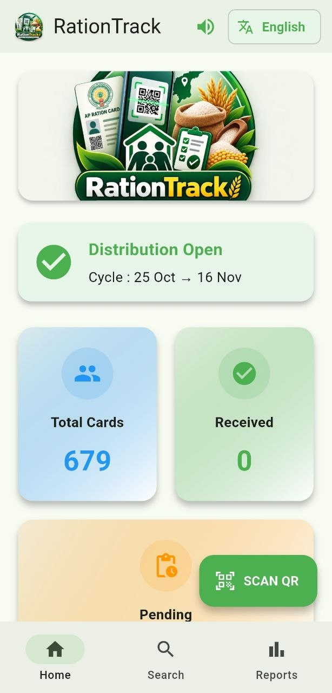
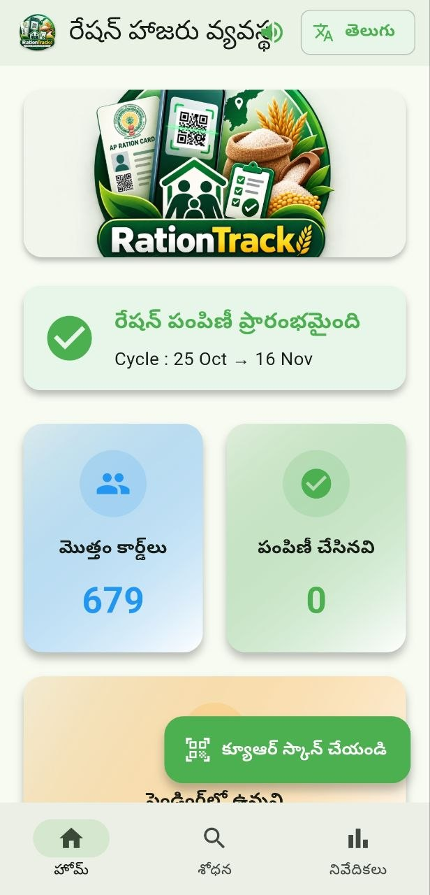
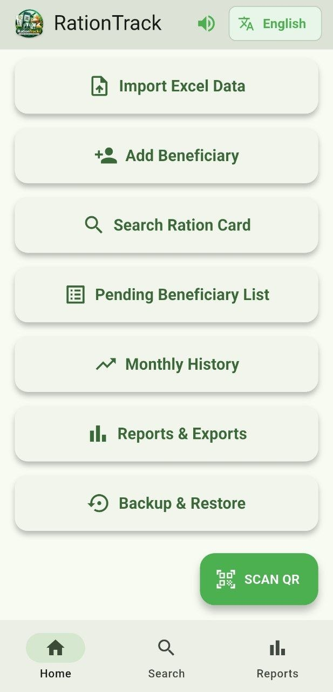
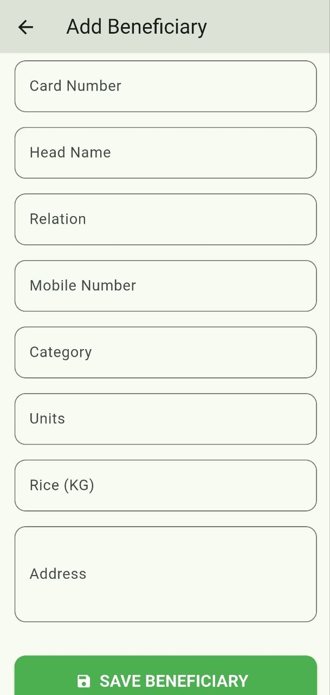

# 📱 RationTrack (Ration Attendance App)

**RationTrack** is a Flutter application that helps ration shop (PDS) dealers and field staff track ration card holder attendance digitally. Scan a card's QR code to mark attendance, keep a local database of card holders, import data from Excel, and generate detailed reports — all offline, on-device.

## 📸 Screenshots

| English Home | Telugu Home (తెలుగు) | Main Menu |
|:---:|:---:|:---:|
|  |  |  |
|  | | |

<!-- More screenshots: QR scanner, reports, backup... -->
<!--  -->

---

## ✨ Features

- 🏠 **Dashboard** — At-a-glance view of attendance status and card holder stats
- 📷 **QR Code Scanning** — Scan ration card QR codes to mark attendance instantly. Supports multiple QR formats:
  - AePDS URLs (`rcno` query parameter)
  - JSON payloads (`cardNumber`, `card_no`, `rationCard`, etc.)
  - Key–value text (`card: AP1234567890`)
  - AP / WAP / RAP / YSR prefixed card numbers
  - Plain 10–12 digit numbers
- ➕ **Card Management** — Add, edit, view and search ration card records (card number, head name, relation, mobile, category, units, rice quota, address)
- 📊 **History Dashboard** — Browse attendance history by date/range
- ⏳ **Pending Screen** — See which card holders have not yet attended
- 🔍 **Search** — Quickly find cards by number, name, or mobile
- 📥 **Excel Import** — Bulk import card holder data from Excel spreadsheets
- 📤 **Reports & Export** — Generate and export reports as **PDF** or **Excel**, share/open directly from the app
- 💾 **Backup & Restore** — Local backup of your entire database
- 🔊 **Voice Announcements** — Text-to-speech announces the card holder name on attendance
- 🌐 **Bilingual** — Full support for **English** and **తెలుగు (Telugu)**, persisted across sessions
- 📴 **Offline First** — All data stored locally in SQLite; no server required

## 🛠 Tech Stack

| Component      | Technology |
|----------------|------------|
| Framework      | [Flutter](https://flutter.dev) (Dart 3.12+) |
| UI             | Material 3, green seed color scheme |
| Database       | [sqflite](https://pub.dev/packages/sqflite) (SQLite) |
| QR Scanning    | [mobile_scanner](https://pub.dev/packages/mobile_scanner) |
| Excel I/O      | [excel](https://pub.dev/packages/excel), [file_picker](https://pub.dev/packages/file_picker) |
| PDF Reports    | [pdf](https://pub.dev/packages/pdf) + [printing](https://pub.dev/packages/printing) |
| Voice (TTS)    | [flutter_tts](https://pub.dev/packages/flutter_tts) |
| Haptics        | [vibration](https://pub.dev/packages/vibration) |
| Persistence    | [shared_preferences](https://pub.dev/packages/shared_preferences) |

## 🚀 Getting Started

### Prerequisites
- [Flutter SDK](https://docs.flutter.dev/get-started/install) (stable channel)
- Android Studio / VS Code with Flutter extensions
- An Android device or emulator (primary target platform)

### Install & Run

```bash
# Clone the repository
git clone https://github.com/Surya-007s/Ration-Attendance-App.git
cd Ration-Attendance-App

# Install dependencies
flutter pub get

# Run in debug mode
flutter run
```

### Build a Release APK

```bash
flutter build apk --release
# Output: build/app/outputs/flutter-apk/app-release.apk
```

### Run Tests

```bash
flutter test
```

## 📂 Project Structure

```
lib/
├── main.dart                     # App entry point & theme
├── models/                       # Data models (RationCard, Attendance, ...)
├── database/                     # SQLite helper & repository layer
├── screens/                      # UI screens
│   ├── dashboard_screen.dart     # Home dashboard
│   ├── qr_scanner_screen.dart    # QR camera scanner
│   ├── add_card_screen.dart      # Create card record
│   ├── edit_card_screen.dart     # Edit card record
│   ├── card_details_screen.dart  # Card details view
│   ├── search_screen.dart        # Card search
│   ├── history_dashboard_screen.dart  # Attendance history
│   ├── pending_screen.dart       # Pending (not attended) list
│   ├── reports_screen.dart       # Reports & exports
│   ├── import_screen.dart        # Excel import
│   └── backup_screen.dart        # Backup & restore
├── services/                     # Business logic (audio, backup, excel, reports)
└── utils/                        # Helpers (QR parser, language, ration cycle)
```

## 🧪 Testing

The project includes unit and widget tests covering the QR parser, card model, ration cycle logic, audio service, backup service, and language manager:

```bash
flutter test
```

## 🤝 Contributing

1. Fork the repository
2. Create a feature branch (`git checkout -b feature/my-feature`)
3. Commit your changes (`git commit -m "Add my feature"`)
4. Push (`git push origin feature/my-feature`)
5. Open a Pull Request

## 📄 License

This project is for personal/community use. All rights reserved © 2026.

---

Made with ❤️ and Flutter
